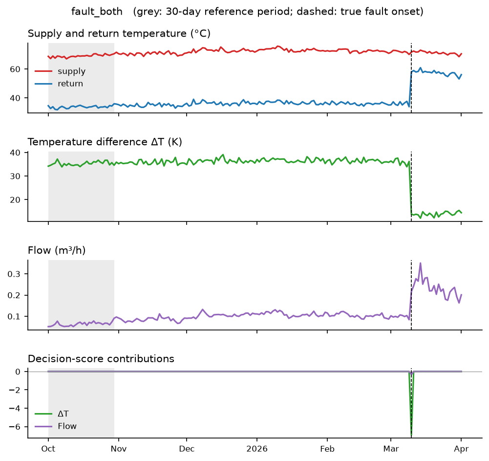
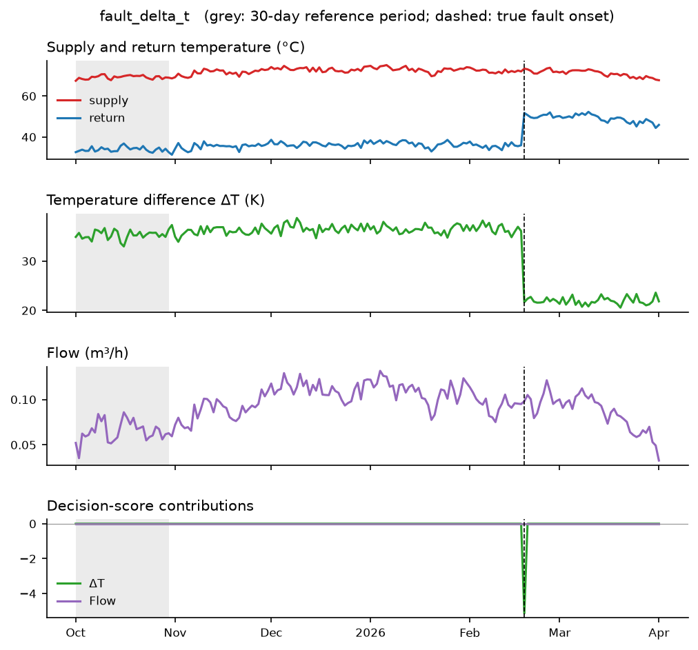
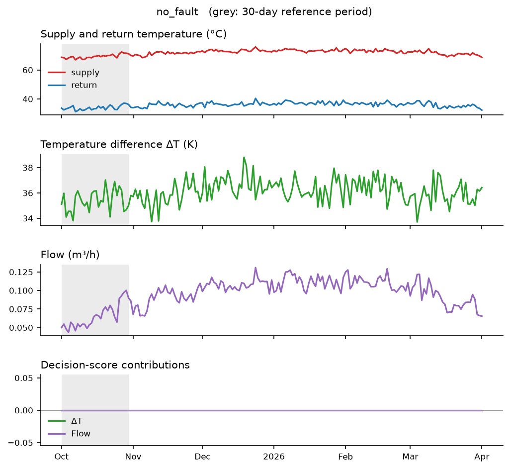

# A physically informed changepoint score for fault prioritisation in district heating

[](https://doi.org/10.5281/zenodo.24175348)

Code accompanying the paper *A Physically Informed Changepoint Score for Fault
Prioritisation in District Heating* (Bugajski, Pedersen, Vera-Valdés,
Pomianowski and Marszal-Pomianowska).

The method runs the physically informed changepoint score for fault detection on the daily temperature difference $\Delta T = T_\mathrm{supply} - T_\mathrm{return}$ and the flow of a district-heating heat meter. BEAST is the changepoint detection algorithm used in the method but it can be replaced with any other changepoint detection algorithm. It scores each detected changepoint by its posterior probability, its deviation from recent operation, its jump size, its local consistency and its physical direction. It then ranks installations for inspection and reports when the strongest unfavourable change happened. The changes are found without using the report date.

The repository contains the method as an installable Python package,
`dhfault`. The heat meter data used in the paper are not public, so the
repository also includes synthetic data that resemble them, and a script that
runs the method on them.

Archived on Zenodo: [doi:10.5281/zenodo.24175348](https://doi.org/10.5281/zenodo.24175348).

## Installation

```bash
pip install git+https://github.com/everval/dh-fault-score
```

This installs `dhfault` with numpy, pandas and Rbeast. For the plots of
`score_windows.py`, add the `plot` extra:
`pip install "dh-fault-score[plot] @ git+https://github.com/everval/dh-fault-score"`.

## Quick start: the synthetic examples

```bash
git clone https://github.com/everval/dh-fault-score
cd dh-fault-score
python -m venv .venv
source .venv/bin/activate        # Windows: .venv\Scripts\activate
pip install -e ".[plot]"         # or: pip install -r requirements.txt && pip install -e .

python generate_data.py          # writes data/synthetic_windows.csv and data/ground_truth.csv
python score_windows.py          # writes results/
```

## The synthetic examples

`generate_data.py` simulates three six-month windows of daily data for a house
in a district-heating network (1 October 2025 to 1 April 2026). Heat demand
follows the outdoor temperature, the supply temperature is
weather-compensated, and in normal operation the installation cools the water
by about 35 K. The flow is whatever delivers the demanded heat at that ΔT.

| Window | What happens | Expected result |
|---|---|---|
| `no_fault` | normal operation throughout | no unfavourable evidence |
| `fault_both` | from 10 March 2026, ΔT falls to about 14 K and the flow rises to deliver the same heat (insufficient cooling) | tier 1, both channels unfavourable |
| `fault_delta_t` | from 18 February 2026, ΔT falls to about 22 K while the flow is unchanged | tier 2, ΔT unfavourable only |

The true onset of each fault is in `data/ground_truth.csv`. The paper never has
this information, but here it lets you compare the dates the method finds with
the truth. The examples are deliberately clean: real faults are often smaller,
more gradual and noisier.

## Output

`python score_windows.py` prints the ranking:

```
1. fault_both     tier 1, joint evidence P_h = 2.23
     ΔT    score    -6.93   strongest unfavourable change on 2026-03-10 (22 days before the window end)
     Flow  score    -0.31   strongest unfavourable change on 2026-03-10 (22 days before the window end)
     true fault onset: 2026-03-10

2. fault_delta_t  tier 2, summed score S_h = -5.14
     ΔT    score    -5.14   strongest unfavourable change on 2026-02-18 (42 days before the window end)
     Flow  score     0.00   no unfavourable change
     true fault onset: 2026-02-18

3. no_fault       tier 2, summed score S_h = 0.00
     ΔT    score     0.00   no unfavourable change
     Flow  score     0.00   no unfavourable change
     true fault onset: none (no fault)
```

and writes to `results/`:

- `summary.csv`: one row per window, with rank, tier, joint evidence $P_h$,
  summed score $S_h$, the score of each channel, and the date of the strongest
  unfavourable change in each channel.
- `changepoints.csv`: every scored changepoint, with its window, channel,
  date, contribution and direction.
- `<window>.png`: the measurements and the decision-score contributions.

The flow scores are small compared with the ΔT scores because flow is
measured in m³/h and its jumps are small. This also holds for the paper's data
(see Appendix A of the paper).

### Plots

Each plot shows supply and return temperature, ΔT, flow and the
decision-score contributions of both channels. The grey band marks the 30-day
reference period and the dashed line marks the true fault onset.

**`fault_both`**: ΔT drops and the flow rises on 10 March 2026. Both channels
give an unfavourable contribution on that day, so the window is in tier 1.



<details>
<summary><b><code>fault_delta_t</code></b>: ΔT drops on 18 February 2026 and the flow is unchanged (tier 2)</summary>



</details>

<details>
<summary><b><code>no_fault</code></b>: normal operation, no unfavourable contributions</summary>



</details>

## Using the package

```python
import numpy as np
import pandas as pd
from dhfault import decision_scores, detect_beast, rank_windows, score_window

data = pd.read_csv("data/synthetic_windows.csv", parse_dates=["timestamp"])
window = data[data.case == "fault_both"]

# The paper's method in one call: BEAST on delta_t and flow, scores, dates.
result = score_window(window)
result.strongest["delta_t"]   # {'date': Timestamp('2026-03-10'), 'days_before_end': 22, 'contribution': -6.93}
result.changepoints           # every scored changepoint, with its date
result.scores["flow"]         # per-day scores over the whole window

# Rank several windows (tier 1 by P_h, then tier 2 by S_h).
results = {case: score_window(w) for case, w in data.groupby("case")}
rank_windows(results)
```

The score does not depend on BEAST. Any detector that returns changepoint
positions can be used: pass a function that takes the values of one channel
and returns the positions (0-based, the first day after the change) and their
probabilities, or `None` if the detector gives none (then p = 1). For example,
PELT from `ruptures` (`pip install ruptures`):

```python
import ruptures as rpt

def pelt(y):
    breaks = rpt.Pelt(model="l2", min_size=2).fit(y).predict(pen=8 * np.var(np.diff(y)) * np.log(len(y)))
    return np.array(breaks[:-1]), None

result = score_window(window, detector=pelt)
```

For changepoints you already have, `decision_scores` scores one channel
directly:

```python
y = window.delta_t.to_numpy()
positions, probabilities = detect_beast(y)
scores = decision_scores(y, positions, probabilities, unfavourable="decrease")
```

The parameters default to the paper's settings and can be changed as keyword
arguments of `decision_scores` and `score_window`: `q=0.99` (probability
threshold), `z_thr=3` (deviation criterion), `baseline=30` (reference period,
not scored), `ref_days=30` (days before a change used for its reference mean
and standard deviation), `w2=2` (local window for Z and C) and `snap=1`
(refinement window).

Rbeast counts time from 1, so the positions returned by `detect_beast` lie one
day after the jump. The paper uses them as they are, and the ±1-day refinement
moves them back to the jump (Appendix A of the paper).

## Running the script on your own data

```bash
python score_windows.py my_windows.csv
```

The CSV needs one row per day with the columns `case` (one id per observation
window), `timestamp`, `delta_t` (K) and `flow` (m³/h). If `temp_supply` and
`temp_return` are present, they are plotted. Use six-month windows of daily
values, as in the paper. The first 30 days of each window serve only as a
reference period and are not scored. Missing days should be interpolated
first.

## Files

| File | Contents |
|---|---|
| `src/dhfault/score.py` | the decision score of one channel, for changepoints from any detector |
| `src/dhfault/beast.py` | BEAST (Rbeast, `season="none"`, seed 18) as in the paper |
| `src/dhfault/window.py` | `score_window`: detection, scores and dates for one window |
| `src/dhfault/ranking.py` | `rank_windows`: the two-tier ranking |
| `score_windows.py` | the command-line script: scores and ranks the windows of a CSV, writes `results/` |
| `generate_data.py` | the synthetic data |
| `tests/` | checks that the package reproduces the paper's analysis code (`tests/reference_scoring.py`, an unchanged copy) exactly, on the synthetic data and on random series; run with `pytest` after `pip install -e ".[test]"` |

## Method in brief

For each channel, BEAST changepoints with posterior probability above 0.99,
after the 30-day reference period, are moved to the largest jump within $\pm 1$
day. They are kept only if the series departs more than three standard
deviations from its mean over the preceding 30 days. Each retained changepoint
contributes

$$
\pm\, p \cdot \log(1 + Z) \cdot \log(1 + J) \cdot \log(1 + C),
$$

where $p$ is the posterior probability, $Z$ the standardised deviation, $J$ the jump
size and $C$ the local consistency. The sign is negative (unfavourable) for a
fall in $\Delta T$ or a rise in flow. Windows with unfavourable evidence in both
channels form the first tier, ranked by the product of that evidence, $P_h$. All
others follow, ranked by the sum of the channel scores, $S_h$. See the paper for
the full definitions.

## Citation

If you use this code, please cite the paper (see `CITATION.cff`). The software is archived on Zenodo at
<https://doi.org/10.5281/zenodo.24175348>.

## License

MIT, see `LICENSE`.
